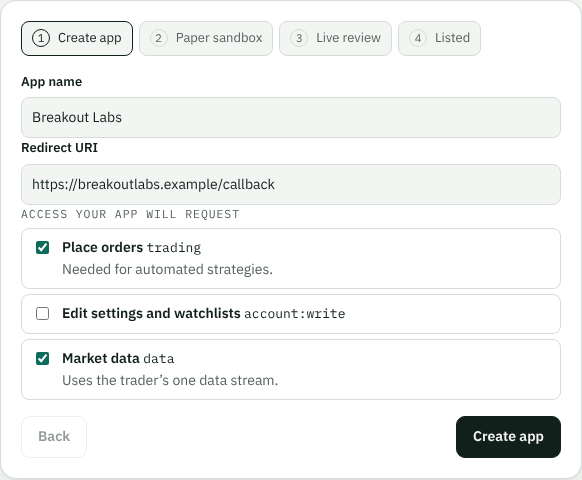
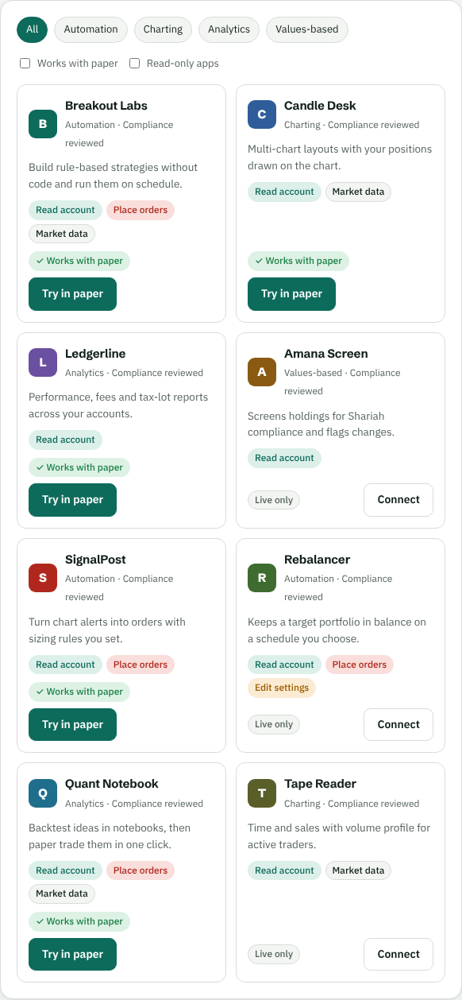
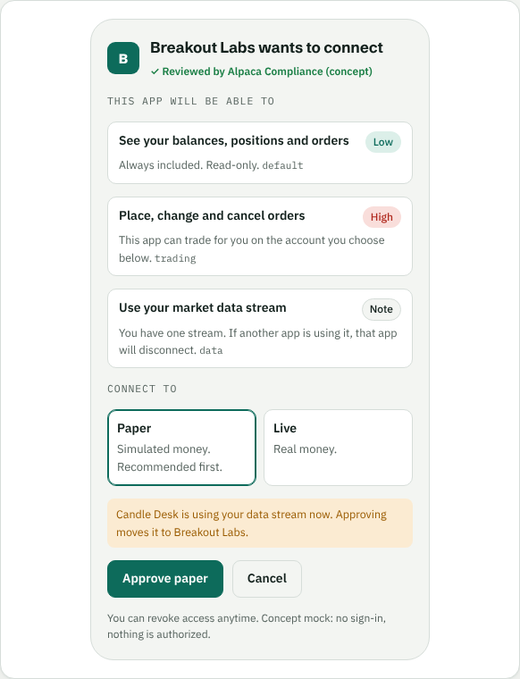
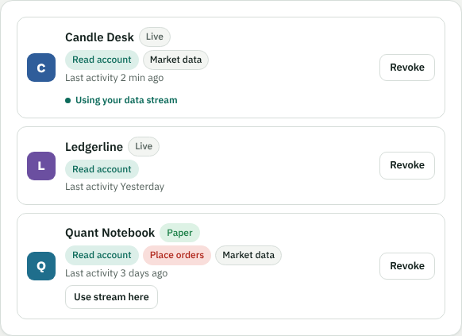

# Self-Serve Connect: a product concept for Alpaca Connect

A clickable product concept for [Alpaca Connect](https://alpaca.markets/connect), the marketplace and OAuth layer that lets third-party apps trade on behalf of Alpaca users.

> **Unofficial.** This is my own concept, built from Alpaca's public documentation. It is not affiliated with or endorsed by Alpaca. Every app, account and number in it is fictional, and the consent screen is a design mock with no sign-in.

## Open it

- **Live:** https://ketan-pansare.github.io/alpaca-connect-concept/
- **Locally:** download the repo and open `index.html` in any browser. No build step and no install.

## The problem

Connect grows when two things are easy: a developer getting from idea to a working paper-trading integration, and a trader understanding exactly what they are authorizing. Reading the public docs, I saw four frictions:

| | Friction | Source |
|---|---|---|
| A | App registration ends with the team following up by email "to complete the remaining process." Partners see no status or timeline. | [Registering Your App](https://docs.alpaca.markets/us/docs/registering-your-app) |
| B | The marketplace lists apps by name and description under one "All" filter, without the access each app requests or whether it works in paper. | [alpaca.markets/connect](https://alpaca.markets/connect) |
| C | Scopes are technical (`account:write`, `trading`, `data`), and without `env` users are asked to authorize live and paper together. | [Using OAuth2 and Trading API](https://docs.alpaca.markets/us/docs/using-oauth2-and-trading-api) |
| D | Most users get one market data stream; a second app gets error 406, "connection limit exceeded." | [Using OAuth2 and Trading API](https://docs.alpaca.markets/us/docs/using-oauth2-and-trading-api) |

## What the concept shows

1. **Partner onboarding.** Instant paper sandbox, a live-review checklist (including monetization disclosure), and a visible review tracker with owner and target date. Compliance review stays human.
2. **Marketplace.** Categories, permission pills colored by risk, a "Works with paper" filter, and a **Try in paper** button.
3. **Consent.** The same OAuth scopes, explained in plain language with risk levels; paper first; a data-stream warning before approval instead of an error after.
4. **Connected apps.** Every connection with account type, permissions and last activity; one tap to move the data stream; in-place revoke.
5. **Metrics and rollout.** North star (trading volume through Connect apps), seven input metrics, and a four-phase rollout ordered by cost and relief.

| Marketplace | Consent | Connected apps |
|---|---|---|
|  |  |  |

## Assumptions

- I don't have Alpaca's internal data, so every metric would be baselined in week one before setting targets.
- The proposed 5-business-day review target is illustrative.
- Optional per-scope consent is a proposal; today the scopes an app requests are granted together.

## Tech

One self-contained HTML file with vanilla JavaScript and Google Fonts. Light and dark themes, works at phone width, and the views are linkable (`#onboard`, `#market`, `#consent`, `#connected`, `#metrics`).

## Related

[Paper Trading Bot](https://github.com/ketan-pansare/alpaca-paper-trading-bot): a paper-only trend-following bot I built on the Alpaca Trading API.

Built by Ketan Pansare · linkedin.com/in/ketanpansare
